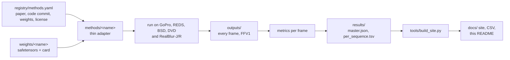

<h1 align="center">deblurring is solved</h1>

<p align="center">Nikita Alutis &nbsp;&middot;&nbsp; Egor Chistov</p>

<p align="center">
  <b>Motion deblurring methods with released weights, run with one protocol on six test sets (four video sets, plus RealBlur-J and RealBlur-R for image methods) and scored frame by frame.</b>
</p>

<p align="center">
  <a href="#leaderboard">Leaderboard</a> &nbsp;&middot;&nbsp;
  <a href="docs/leaderboard.csv">All results (CSV)</a> &nbsp;&middot;&nbsp;
  <a href="PROTOCOL.md">Protocol</a> &nbsp;&middot;&nbsp;
  <a href="METRICS.md">Metrics</a> &nbsp;&middot;&nbsp;
  <a href="WEIGHTS.md">Weights</a>
</p>

## Leaderboard

<!-- generated:start (tools/build_site.py writes this block; edit the script, not the text) -->
> [!NOTE]
> Numbers as of 2026-11-21: 29 of 152 variants scored on all their sets (six for image methods, four for video methods), 121 on some. GoPro-trained weights (other training sets are on the site), PSNR in dB (RealBlur: official ECC-aligned PSNR), sorted by PSNR. The full table is in [`docs/leaderboard.csv`](docs/leaderboard.csv) and on the interactive leaderboard in [`docs/`](docs/) (GitHub Pages).

### GoPro

| # | Method | Type | Params, M | PSNR | SSIM | LPIPS |
|---:|---|---|---:|---:|---:|---:|
| 1 | **BSSTNet** <sub>clip, CVPR 2024</sub> | video | 46.7 | 35.97 | 0.966 | 0.057 |
| 2 | **DSTNet+ L** <sub>clip, large, arXiv 2024</sub> | video | 14.1 | 35.71 | 0.964 | 0.059 |
| 3 | **Shift-Net+** <sub>clip, CVPR 2023</sub> | video | 13.0 | 35.65 | 0.964 | 0.059 |
| 4 | **STDANet++** <sub>clip, tiled, TCSVT 2025</sub> | video | 11.5 | 35.29 | 0.961 | 0.065 |
| 5 | **RVRT** <sub>clip, NeurIPS 2022</sub> | video | 13.6 | 34.92 | 0.959 | 0.067 |
| 6 | **VRT** <sub>clip, TIP 2022</sub> | video | 18.6 | 34.81 | 0.957 | 0.069 |
| 7 | **Turtle** <sub>tiled, NeurIPS 2024</sub> | video | 59.1 | 34.56 | 0.955 | 0.072 |
| 8 | **EVSSM** <sub>whole, CVPR 2025</sub> | image | 17.1 | 34.51 | 0.954 | 0.068 |
| 9 | **AdaRevD-B** <sub>tiled, CVPR 2024</sub> | image | – | 34.50 | 0.954 | 0.073 |
| 10 | **DSTNet+ base** <sub>clip, arXiv 2024</sub> | video | 3.9 | 34.49 | 0.955 | 0.073 |

<details>
<summary>All 116 rows on GoPro</summary>

| # | Method | Type | Params, M | PSNR | SSIM | LPIPS |
|---:|---|---|---:|---:|---:|---:|
| 1 | **BSSTNet** <sub>clip, CVPR 2024</sub> | video | 46.7 | 35.97 | 0.966 | 0.057 |
| 2 | **DSTNet+ L** <sub>clip, large, arXiv 2024</sub> | video | 14.1 | 35.71 | 0.964 | 0.059 |
| 3 | **Shift-Net+** <sub>clip, CVPR 2023</sub> | video | 13.0 | 35.65 | 0.964 | 0.059 |
| 4 | **STDANet++** <sub>clip, tiled, TCSVT 2025</sub> | video | 11.5 | 35.29 | 0.961 | 0.065 |
| 5 | **RVRT** <sub>clip, NeurIPS 2022</sub> | video | 13.6 | 34.92 | 0.959 | 0.067 |
| 6 | **VRT** <sub>clip, TIP 2022</sub> | video | 18.6 | 34.81 | 0.957 | 0.069 |
| 7 | **Turtle** <sub>tiled, NeurIPS 2024</sub> | video | 59.1 | 34.56 | 0.955 | 0.072 |
| 8 | **EVSSM** <sub>whole, CVPR 2025</sub> | image | 17.1 | 34.51 | 0.954 | 0.068 |
| 9 | **AdaRevD-B** <sub>tiled, CVPR 2024</sub> | image | – | 34.50 | 0.954 | 0.073 |
| 10 | **DSTNet+ base** <sub>clip, arXiv 2024</sub> | video | 3.9 | 34.49 | 0.955 | 0.073 |
| 11 | **Concertormer** <sub>TLC, arXiv 2025</sub> | image | 50.5 | 34.41 | 0.954 | 0.070 |
| 12 | **FFTformer + ID-Blau** <sub>whole, CVPR 2024</sub> | image | 16.6 | 34.29 | 0.953 | 0.069 |
| 13 | **StarIR** <sub>TLC, 2025</sub> | image | 18.7 | 34.27 | 0.953 | 0.071 |
| 14 | **Concertormer-lite** <sub>TLC, small, arXiv 2025</sub> | image | 29.0 | 34.18 | 0.952 | 0.072 |
| 15 | **FFTformer** <sub>whole, CVPR 2023</sub> | image | 16.6 | 34.16 | 0.952 | 0.071 |
| 16 | **DSTNet** <sub>clip, CVPR 2023</sub> | video | 7.5 | 34.16 | 0.952 | 0.073 |
| 17 | **UFPNet** <sub>TLC, CVPR 2023</sub> | image | 80.3 | 34.09 | 0.950 | 0.076 |
| 18 | **Concertormer** <sub>whole, arXiv 2025</sub> | image | 50.5 | 34.07 | 0.951 | 0.073 |
| 19 | **BasicVSR++** <sub>clip, CVPR 2022</sub> | video | 9.8 | 34.04 | 0.952 | 0.078 |
| 20 | **GRL-B** <sub>tiled, CVPR 2023</sub> | image | 19.8 | 33.93 | 0.949 | 0.074 |
| 21 | **XYScanNet** <sub>whole, CVPRW 2025</sub> | image | – | 33.91 | 0.949 | 0.067 |
| 22 | **Concertormer-lite** <sub>whole, small, arXiv 2025</sub> | image | 29.0 | 33.86 | 0.950 | 0.075 |
| 23 | **F-NAFNet-64** <sub>whole, AAAI 2023</sub> | image | 68.0 | 33.85 | 0.948 | 0.075 |
| 24 | **MLWNet-B** <sub>TLC, CVPR 2024</sub> | image | 95.1 | 33.83 | 0.949 | 0.076 |
| 25 | **LaKDNet-L** <sub>whole, arXiv 2023</sub> | image | 37.5 | 33.72 | 0.947 | 0.076 |
| 26 | **StarIR** <sub>whole, 2025</sub> | image | 18.7 | 33.72 | 0.949 | 0.074 |
| 27 | **NAFNet-64** <sub>TLC, ECCV 2022</sub> | image | 67.9 | 33.71 | 0.947 | 0.078 |
| 28 | **MaIR** <sub>whole, CVPR 2025</sub> | image | – | 33.69 | 0.947 | 0.079 |
| 29 | **GRL-B** <sub>whole, CVPR 2023</sub> | image | 19.8 | 33.66 | 0.947 | 0.076 |
| 30 | **Stripformer + ID-Blau** <sub>whole, CVPR 2024</sub> | image | 19.7 | 33.66 | 0.947 | 0.071 |
| 31 | **M3SNet-64** <sub>TLC, VisComp 2024</sub> | image | 66.4 | 33.64 | 0.942 | 0.085 |
| 32 | **DeblurDiNAT-L** <sub>whole, arXiv 2024</sub> | image | – | 33.63 | 0.947 | 0.071 |
| 33 | **EAMamba** <sub>whole, ICCV 2025</sub> | image | – | 33.58 | 0.946 | 0.079 |
| 34 | **Restormer + ID-Blau** <sub>whole, CVPR 2024</sub> | image | 26.1 | 33.51 | 0.946 | 0.078 |
| 35 | **ALGNet** <sub>TLC, ACMMM 2024</sub> | image | – | 33.49 | 0.943 | 0.089 |
| 36 | **UFPNet** <sub>whole, CVPR 2023</sub> | image | 80.3 | 33.46 | 0.944 | 0.080 |
| 37 | **AdaRevD-B** <sub>whole, CVPR 2024</sub> | image | – | 33.44 | 0.944 | 0.090 |
| 38 | **MSFS-Net** <sub>TLC, TCSVT 2023</sub> | image | 21.6 | 33.44 | 0.944 | 0.083 |
| 39 | **ShuffleFormer** <sub>tiled, ICML 2023</sub> | image | 50.6 | 33.38 | 0.945 | 0.083 |
| 40 | **MLWNet-B** <sub>whole, CVPR 2024</sub> | image | 95.1 | 33.37 | 0.945 | 0.079 |
| 41 | **X-Restormer** <sub>whole, ECCV 2024</sub> | image | 26.0 | 33.37 | 0.946 | 0.076 |
| 42 | **RNN-MBP** <sub>clip, AAAI 2022</sub> | video | 16.4 | 33.36 | 0.942 | 0.083 |
| 43 | **LaKDNet-S** <sub>whole, small, arXiv 2023</sub> | image | 17.1 | 33.35 | 0.944 | 0.082 |
| 44 | **LoFormer-L** <sub>whole, ACMMM 2024</sub> | image | 49.0 | 33.35 | 0.943 | 0.083 |
| 45 | **RevD-S** <sub>whole, small, CVPR 2024</sub> | image | – | 33.34 | 0.943 | 0.088 |
| 46 | **F-MIMO+** <sub>tiled, large, AAAI 2023</sub> | image | 19.5 | 33.34 | 0.944 | 0.083 |
| 47 | **HI-Diff** <sub>whole, NeurIPS 2023</sub> | image | – | 33.32 | 0.944 | 0.080 |
| 48 | **DiffIR** <sub>whole, ICCV 2023</sub> | image | – | 33.31 | 0.945 | 0.079 |
| 49 | **MSDI-Net** <sub>tiled, ECCV 2022</sub> | image | 246.9 | 33.28 | 0.942 | 0.080 |
| 50 | **FSNet** <sub>whole, TPAMI 2023</sub> | image | 13.3 | 33.26 | 0.943 | 0.081 |
| 51 | **ChaIR** <sub>whole, KBS 2023</sub> | image | 15.0 | 33.25 | 0.943 | 0.081 |
| 52 | **Stoformer** <sub>tiled, NeurIPS 2022</sub> | image | 50.5 | 33.23 | 0.943 | 0.085 |
| 53 | **SFNet** <sub>TLC, ICLR 2023</sub> | image | 13.3 | 33.23 | 0.943 | 0.080 |
| 54 | **ConvIR-L** <sub>whole, TPAMI 2024</sub> | image | 14.8 | 33.22 | 0.943 | 0.083 |
| 55 | **Stoformer** <sub>whole, NeurIPS 2022</sub> | image | 50.5 | 33.19 | 0.943 | 0.084 |
| 56 | **VDTR** <sub>window, TCSVT 2022</sub> | video | 23.1 | 33.19 | 0.940 | 0.087 |
| 57 | **DGUNet+** <sub>whole, large, CVPR 2022</sub> | image | 69.6 | 33.17 | 0.942 | 0.082 |
| 58 | **F-NAFNet-32** <sub>whole, small, AAAI 2023</sub> | image | 17.8 | 33.12 | 0.941 | 0.085 |
| 59 | **IRNeXt (16 blocks)** <sub>whole, large, ICML 2023</sub> | image | 14.8 | 33.12 | 0.942 | 0.082 |
| 60 | **IRNeXt** <sub>whole, ICML 2023</sub> | image | 13.2 | 33.09 | 0.941 | 0.084 |
| 61 | **Stripformer** <sub>whole, ECCV 2022</sub> | image | 19.7 | 33.08 | 0.941 | 0.077 |
| 62 | **NAFNet-64** <sub>whole, ECCV 2022</sub> | image | 67.9 | 33.08 | 0.942 | 0.082 |
| 63 | **FGST** <sub>window, ICML 2022</sub> | video | 9.7 | 33.03 | 0.947 | 0.081 |
| 64 | **M3SNet-64** <sub>whole, VisComp 2024</sub> | image | 66.4 | 33.02 | 0.936 | 0.089 |
| 65 | **MSSNet** <sub>whole, ECCVW 2022</sub> | image | 15.6 | 33.01 | 0.940 | 0.086 |
| 66 | **F-MIMO** <sub>tiled, AAAI 2023</sub> | image | 8.2 | 32.99 | 0.941 | 0.088 |
| 67 | **CDVD-TSPNL** <sub>clip, TPAMI 2023</sub> | video | 5.5 | 32.93 | 0.942 | 0.090 |
| 68 | **MIMO-UNet+ + ID-Blau** <sub>whole, large, CVPR 2024</sub> | image | 16.1 | 32.93 | 0.939 | 0.088 |
| 69 | **Restormer** <sub>whole, CVPR 2022</sub> | image | 26.1 | 32.92 | 0.940 | 0.084 |
| 70 | **ShuffleFormer** <sub>whole, ICML 2023</sub> | image | 50.6 | 32.90 | 0.940 | 0.086 |
| 71 | **HINet** <sub>whole, CVPRW 2021</sub> | image | 88.7 | 32.90 | 0.938 | 0.086 |
| 72 | **M3SNet-32** <sub>TLC, small, VisComp 2024</sub> | image | 16.7 | 32.90 | 0.938 | 0.093 |
| 73 | **DeepRFT+** <sub>TLC, large, arXiv 2021</sub> | image | 23.0 | 32.90 | 0.939 | 0.083 |
| 74 | **ALGNet** <sub>whole, ACMMM 2024</sub> | image | – | 32.89 | 0.936 | 0.093 |
| 75 | **NAFNet-32** <sub>TLC, small, ECCV 2022</sub> | image | 17.1 | 32.87 | 0.938 | 0.093 |
| 76 | **ShuffleFormer (1 pass)** <sub>whole, 1pass, ICML 2023</sub> | image | 50.6 | 32.86 | 0.940 | 0.087 |
| 77 | **SFNet** <sub>whole, ICLR 2023</sub> | image | 13.3 | 32.77 | 0.938 | 0.084 |
| 78 | **MSFS-Net** <sub>whole, TCSVT 2023</sub> | image | 21.6 | 32.72 | 0.936 | 0.088 |
| 79 | **DGUNet** <sub>whole, CVPR 2022</sub> | image | 17.3 | 32.71 | 0.937 | 0.091 |
| 80 | **MPRNet** <sub>whole, CVPR 2021</sub> | image | 20.1 | 32.66 | 0.936 | 0.089 |
| 81 | **MSDI-Net** <sub>whole, ECCV 2022</sub> | image | 246.9 | 32.59 | 0.937 | 0.080 |
| 82 | **STDAN** <sub>window, ECCV 2022</sub> | video | 13.8 | 32.51 | 0.936 | 0.097 |
| 83 | **DeepRFT+** <sub>whole, large, arXiv 2021</sub> | image | 23.0 | 32.45 | 0.933 | 0.097 |
| 84 | **MIMO-UNet+** <sub>whole, large, ICCV 2021</sub> | image | 16.1 | 32.44 | 0.933 | 0.090 |
| 85 | **F-MIMO-S** <sub>tiled, small, AAAI 2023</sub> | image | 4.4 | 32.44 | 0.934 | 0.097 |
| 86 | **F-MIMO+** <sub>whole, large, AAAI 2023</sub> | image | 19.5 | 32.38 | 0.932 | 0.098 |
| 87 | **DeepRFT** <sub>TLC, arXiv 2021</sub> | image | 9.6 | 32.35 | 0.933 | 0.091 |
| 88 | **M3SNet-32** <sub>whole, small, VisComp 2024</sub> | image | 16.7 | 32.32 | 0.931 | 0.098 |
| 89 | **NAFNet-32** <sub>whole, small, ECCV 2022</sub> | image | 17.1 | 32.29 | 0.932 | 0.098 |
| 90 | **DeepRFT-S** <sub>TLC, small, arXiv 2021</sub> | image | 5.1 | 32.13 | 0.931 | 0.091 |
| 91 | **MSSNet-small** <sub>whole, small, ECCVW 2022</sub> | image | 6.8 | 32.02 | 0.928 | 0.100 |
| 92 | **MISCFilter** <sub>whole, CVPR 2024</sub> | image | – | 32.02 | 0.927 | 0.105 |
| 93 | **DeepRFT** <sub>whole, arXiv 2021</sub> | image | 9.6 | 31.91 | 0.926 | 0.105 |
| 94 | **VRNN** <sub>clip, PR 2023</sub> | video | 5.0 | 31.81 | 0.924 | 0.102 |
| 95 | **MemDeblur** <sub>clip, CVPR 2022</sub> | video | 7.0 | 31.78 | 0.923 | 0.115 |
| 96 | **F-MIMO** <sub>whole, AAAI 2023</sub> | image | 8.2 | 31.78 | 0.924 | 0.107 |
| 97 | **MIMO-UNet** <sub>whole, ICCV 2021</sub> | image | 6.8 | 31.72 | 0.924 | 0.101 |
| 98 | **CDVD-TSP** <sub>window, CVPR 2020</sub> | video | 16.2 | 31.61 | 0.927 | 0.114 |
| 99 | **DeepRFT-S** <sub>whole, small, arXiv 2021</sub> | image | 5.1 | 31.36 | 0.918 | 0.115 |
| 100 | **F-MIMO-S** <sub>whole, small, AAAI 2023</sub> | image | 4.4 | 31.20 | 0.915 | 0.119 |
| 101 | **DBGAN** <sub>whole, CVPR 2020</sub> | image | 11.6 | 31.18 | 0.916 | 0.110 |
| 102 | **MT-RNN** <sub>whole, ECCV 2020</sub> | image | 2.6 | 31.13 | 0.915 | 0.123 |
| 103 | **Motion-ETR** <sub>whole, TPAMI 2021</sub> | image | 6.5 | 31.07 | 0.913 | 0.117 |
| 104 | **PSS-NSC** <sub>whole, CVPR 2019</sub> | image | 3.9 | 30.99 | 0.913 | 0.122 |
| 105 | **ESTRNN** <sub>recurrent, ECCV 2020</sub> | video | 2.5 | 30.90 | 0.908 | 0.143 |
| 106 | **SIUN** <sub>whole, Access 2020</sub> | image | 6.3 | 30.27 | 0.902 | 0.127 |
| 107 | **DMPHN-1-2-4** <sub>whole, CVPR 2019</sub> | image | 5.4 | 30.21 | 0.899 | 0.133 |
| 108 | **TSRN-RTVD** <sub>recurrent, arXiv 2026</sub> | video | 4.9 | 30.07 | 0.897 | 0.141 |
| 109 | **MMP-RNN** <sub>recurrent, ECCV 2022</sub> | video | 4.1 | 29.95 | 0.922 | 0.111 |
| 110 | **PVDNet** <sub>window+prev out, TOG 2021</sub> | video | 10.5 | 28.81 | 0.898 | 0.130 |
| 111 | **STDANet++** <sub>clip, whole, TCSVT 2025</sub> | video | 11.5 | 28.36 | 0.859 | 0.197 |
| 112 | **RT-Focuser** <sub>whole, arXiv 2025</sub> | image | 5.9 | 28.30 | 0.880 | 0.161 |
| 113 | **RT-VDBLR** <sub>recurrent, CGF 2022</sub> | video | 1.0 | 28.04 | 0.874 | 0.165 |
| 114 | **DeepDeblur** <sub>whole, CVPR 2017</sub> | image | 11.7 | 27.83 | 0.871 | 0.157 |
| 115 | **Ghost-DeblurGAN** <sub>whole, IROS 2022</sub> | image | 1.5 | 27.56 | 0.843 | 0.161 |
| 116 | **MISCFilter** <sub>tiled, CVPR 2024</sub> | image | – | 25.87 | 0.804 | 0.227 |

</details>

### REDS

| # | Method | Type | Params, M | PSNR | SSIM | LPIPS |
|---:|---|---|---:|---:|---:|---:|
| 1 | **VRNN** <sub>clip, PR 2023</sub> | video | 5.0 | 29.10 | 0.857 | 0.179 |
| 2 | **MMP-RNN** <sub>recurrent, ECCV 2022</sub> | video | 4.1 | 28.72 | 0.851 | 0.201 |
| 3 | **STDAN** <sub>window, ECCV 2022</sub> | video | 13.8 | 28.65 | 0.854 | 0.201 |
| 4 | **PVDNet** <sub>window+prev out, TOG 2021</sub> | video | 10.5 | 28.64 | 0.852 | 0.201 |
| 5 | **RNN-MBP** <sub>clip, AAAI 2022</sub> | video | 16.4 | 28.53 | 0.837 | 0.201 |
| 6 | **RT-VDBLR** <sub>recurrent, CGF 2022</sub> | video | 1.0 | 28.30 | 0.830 | 0.233 |
| 7 | **ALGNet** <sub>TLC, ACMMM 2024</sub> | image | – | 28.20 | 0.856 | 0.197 |
| 8 | **MSFS-Net** <sub>TLC, TCSVT 2023</sub> | image | 21.6 | 28.04 | 0.848 | 0.183 |
| 9 | **DeepDeblur** <sub>whole, CVPR 2017</sub> | image | 11.7 | 27.91 | 0.839 | 0.220 |
| 10 | **ALGNet** <sub>whole, ACMMM 2024</sub> | image | – | 27.85 | 0.842 | 0.215 |

<details>
<summary>All 116 rows on REDS</summary>

| # | Method | Type | Params, M | PSNR | SSIM | LPIPS |
|---:|---|---|---:|---:|---:|---:|
| 1 | **VRNN** <sub>clip, PR 2023</sub> | video | 5.0 | 29.10 | 0.857 | 0.179 |
| 2 | **MMP-RNN** <sub>recurrent, ECCV 2022</sub> | video | 4.1 | 28.72 | 0.851 | 0.201 |
| 3 | **STDAN** <sub>window, ECCV 2022</sub> | video | 13.8 | 28.65 | 0.854 | 0.201 |
| 4 | **PVDNet** <sub>window+prev out, TOG 2021</sub> | video | 10.5 | 28.64 | 0.852 | 0.201 |
| 5 | **RNN-MBP** <sub>clip, AAAI 2022</sub> | video | 16.4 | 28.53 | 0.837 | 0.201 |
| 6 | **RT-VDBLR** <sub>recurrent, CGF 2022</sub> | video | 1.0 | 28.30 | 0.830 | 0.233 |
| 7 | **ALGNet** <sub>TLC, ACMMM 2024</sub> | image | – | 28.20 | 0.856 | 0.197 |
| 8 | **MSFS-Net** <sub>TLC, TCSVT 2023</sub> | image | 21.6 | 28.04 | 0.848 | 0.183 |
| 9 | **DeepDeblur** <sub>whole, CVPR 2017</sub> | image | 11.7 | 27.91 | 0.839 | 0.220 |
| 10 | **ALGNet** <sub>whole, ACMMM 2024</sub> | image | – | 27.85 | 0.842 | 0.215 |
| 11 | **VRT** <sub>clip, TIP 2022</sub> | video | 18.6 | 27.74 | 0.879 | 0.144 |
| 12 | **RVRT** <sub>clip, NeurIPS 2022</sub> | video | 13.6 | 27.69 | 0.884 | 0.139 |
| 13 | **UFPNet** <sub>TLC, CVPR 2023</sub> | image | 80.3 | 27.67 | 0.848 | 0.190 |
| 14 | **AdaRevD-B** <sub>tiled, CVPR 2024</sub> | image | – | 27.66 | 0.850 | 0.194 |
| 15 | **MSFS-Net** <sub>whole, TCSVT 2023</sub> | image | 21.6 | 27.66 | 0.832 | 0.198 |
| 16 | **UFPNet** <sub>whole, CVPR 2023</sub> | image | 80.3 | 27.58 | 0.840 | 0.199 |
| 17 | **CDVD-TSPNL** <sub>clip, TPAMI 2023</sub> | video | 5.5 | 27.55 | 0.867 | 0.169 |
| 18 | **AdaRevD-B** <sub>whole, CVPR 2024</sub> | image | – | 27.47 | 0.836 | 0.212 |
| 19 | **STDANet++** <sub>clip, tiled, TCSVT 2025</sub> | video | 11.5 | 27.46 | 0.874 | 0.144 |
| 20 | **RevD-S** <sub>whole, small, CVPR 2024</sub> | image | – | 27.46 | 0.835 | 0.211 |
| 21 | **BasicVSR++** <sub>clip, CVPR 2022</sub> | video | 9.8 | 27.44 | 0.872 | 0.153 |
| 22 | **ShuffleFormer** <sub>tiled, ICML 2023</sub> | image | 50.6 | 27.40 | 0.846 | 0.189 |
| 23 | **DSTNet+ base** <sub>clip, arXiv 2024</sub> | video | 3.9 | 27.38 | 0.858 | 0.168 |
| 24 | **Concertormer** <sub>TLC, arXiv 2025</sub> | image | 50.5 | 27.35 | 0.850 | 0.182 |
| 25 | **Turtle** <sub>tiled, NeurIPS 2024</sub> | video | 59.1 | 27.35 | 0.847 | 0.184 |
| 26 | **DSTNet** <sub>clip, CVPR 2023</sub> | video | 7.5 | 27.29 | 0.854 | 0.177 |
| 27 | **Stoformer** <sub>whole, NeurIPS 2022</sub> | image | 50.5 | 27.28 | 0.841 | 0.191 |
| 28 | **F-MIMO+** <sub>tiled, large, AAAI 2023</sub> | image | 19.5 | 27.28 | 0.843 | 0.190 |
| 29 | **RT-Focuser** <sub>whole, arXiv 2025</sub> | image | 5.9 | 27.27 | 0.812 | 0.258 |
| 30 | **Stoformer** <sub>tiled, NeurIPS 2022</sub> | image | 50.5 | 27.27 | 0.841 | 0.192 |
| 31 | **Concertormer** <sub>whole, arXiv 2025</sub> | image | 50.5 | 27.25 | 0.844 | 0.188 |
| 32 | **MaIR** <sub>whole, CVPR 2025</sub> | image | – | 27.25 | 0.839 | 0.192 |
| 33 | **MemDeblur** <sub>clip, CVPR 2022</sub> | video | 7.0 | 27.24 | 0.838 | 0.210 |
| 34 | **ShuffleFormer** <sub>whole, ICML 2023</sub> | image | 50.6 | 27.24 | 0.837 | 0.197 |
| 35 | **ShuffleFormer (1 pass)** <sub>whole, 1pass, ICML 2023</sub> | image | 50.6 | 27.22 | 0.836 | 0.199 |
| 36 | **Shift-Net+** <sub>clip, CVPR 2023</sub> | video | 13.0 | 27.22 | 0.852 | 0.170 |
| 37 | **Stripformer** <sub>whole, ECCV 2022</sub> | image | 19.7 | 27.18 | 0.838 | 0.176 |
| 38 | **Stripformer + ID-Blau** <sub>whole, CVPR 2024</sub> | image | 19.7 | 27.18 | 0.846 | 0.175 |
| 39 | **CDVD-TSP** <sub>window, CVPR 2020</sub> | video | 16.2 | 27.17 | 0.852 | 0.196 |
| 40 | **EAMamba** <sub>whole, ICCV 2025</sub> | image | – | 27.17 | 0.834 | 0.191 |
| 41 | **MISCFilter** <sub>whole, CVPR 2024</sub> | image | – | 27.14 | 0.822 | 0.225 |
| 42 | **GRL-B** <sub>tiled, CVPR 2023</sub> | image | 19.8 | 27.10 | 0.832 | 0.194 |
| 43 | **X-Restormer** <sub>whole, ECCV 2024</sub> | image | 26.0 | 27.09 | 0.836 | 0.192 |
| 44 | **F-MIMO** <sub>tiled, AAAI 2023</sub> | image | 8.2 | 27.08 | 0.831 | 0.212 |
| 45 | **DSTNet+ L** <sub>clip, large, arXiv 2024</sub> | video | 14.1 | 27.07 | 0.853 | 0.157 |
| 46 | **LaKDNet-S** <sub>whole, small, arXiv 2023</sub> | image | 17.1 | 27.05 | 0.835 | 0.189 |
| 47 | **GRL-B** <sub>whole, CVPR 2023</sub> | image | 19.8 | 27.05 | 0.828 | 0.197 |
| 48 | **VDTR** <sub>window, TCSVT 2022</sub> | video | 23.1 | 27.05 | 0.846 | 0.180 |
| 49 | **LaKDNet-L** <sub>whole, arXiv 2023</sub> | image | 37.5 | 27.03 | 0.839 | 0.187 |
| 50 | **M3SNet-32** <sub>TLC, small, VisComp 2024</sub> | image | 16.7 | 27.03 | 0.830 | 0.214 |
| 51 | **DeepRFT+** <sub>TLC, large, arXiv 2021</sub> | image | 23.0 | 27.03 | 0.833 | 0.191 |
| 52 | **DeblurDiNAT-L** <sub>whole, arXiv 2024</sub> | image | – | 27.00 | 0.842 | 0.176 |
| 53 | **TSRN-RTVD** <sub>recurrent, arXiv 2026</sub> | video | 4.9 | 26.99 | 0.830 | 0.218 |
| 54 | **F-MIMO-S** <sub>tiled, small, AAAI 2023</sub> | image | 4.4 | 26.97 | 0.824 | 0.223 |
| 55 | **M3SNet-32** <sub>whole, small, VisComp 2024</sub> | image | 16.7 | 26.96 | 0.822 | 0.220 |
| 56 | **DGUNet** <sub>whole, CVPR 2022</sub> | image | 17.3 | 26.96 | 0.821 | 0.212 |
| 57 | **SFNet** <sub>whole, ICLR 2023</sub> | image | 13.3 | 26.96 | 0.825 | 0.206 |
| 58 | **Concertormer-lite** <sub>TLC, small, arXiv 2025</sub> | image | 29.0 | 26.96 | 0.837 | 0.193 |
| 59 | **HI-Diff** <sub>whole, NeurIPS 2023</sub> | image | – | 26.96 | 0.829 | 0.203 |
| 60 | **Restormer** <sub>whole, CVPR 2022</sub> | image | 26.1 | 26.93 | 0.820 | 0.211 |
| 61 | **StarIR** <sub>TLC, 2025</sub> | image | 18.7 | 26.93 | 0.839 | 0.192 |
| 62 | **DGUNet+** <sub>whole, large, CVPR 2022</sub> | image | 69.6 | 26.92 | 0.822 | 0.206 |
| 63 | **M3SNet-64** <sub>TLC, VisComp 2024</sub> | image | 66.4 | 26.92 | 0.830 | 0.208 |
| 64 | **Concertormer-lite** <sub>whole, small, arXiv 2025</sub> | image | 29.0 | 26.92 | 0.827 | 0.202 |
| 65 | **EVSSM** <sub>whole, CVPR 2025</sub> | image | 17.1 | 26.91 | 0.848 | 0.178 |
| 66 | **Restormer + ID-Blau** <sub>whole, CVPR 2024</sub> | image | 26.1 | 26.90 | 0.824 | 0.206 |
| 67 | **ChaIR** <sub>whole, KBS 2023</sub> | image | 15.0 | 26.90 | 0.825 | 0.196 |
| 68 | **F-MIMO+** <sub>whole, large, AAAI 2023</sub> | image | 19.5 | 26.90 | 0.813 | 0.224 |
| 69 | **DeepRFT-S** <sub>TLC, small, arXiv 2021</sub> | image | 5.1 | 26.89 | 0.824 | 0.212 |
| 70 | **XYScanNet** <sub>whole, CVPRW 2025</sub> | image | – | 26.88 | 0.840 | 0.175 |
| 71 | **DeepRFT** <sub>whole, arXiv 2021</sub> | image | 9.6 | 26.87 | 0.809 | 0.229 |
| 72 | **HINet** <sub>whole, CVPRW 2021</sub> | image | 88.7 | 26.87 | 0.820 | 0.190 |
| 73 | **M3SNet-64** <sub>whole, VisComp 2024</sub> | image | 66.4 | 26.87 | 0.821 | 0.215 |
| 74 | **MPRNet** <sub>whole, CVPR 2021</sub> | image | 20.1 | 26.85 | 0.816 | 0.202 |
| 75 | **MSSNet-small** <sub>whole, small, ECCVW 2022</sub> | image | 6.8 | 26.85 | 0.828 | 0.198 |
| 76 | **NAFNet-64** <sub>whole, ECCV 2022</sub> | image | 67.9 | 26.85 | 0.822 | 0.199 |
| 77 | **LoFormer-L** <sub>whole, ACMMM 2024</sub> | image | 49.0 | 26.84 | 0.824 | 0.202 |
| 78 | **ESTRNN** <sub>recurrent, ECCV 2020</sub> | video | 2.5 | 26.84 | 0.817 | 0.246 |
| 79 | **SFNet** <sub>TLC, ICLR 2023</sub> | image | 13.3 | 26.83 | 0.826 | 0.205 |
| 80 | **MT-RNN** <sub>whole, ECCV 2020</sub> | image | 2.6 | 26.83 | 0.814 | 0.229 |
| 81 | **DeepRFT+** <sub>whole, large, arXiv 2021</sub> | image | 23.0 | 26.82 | 0.809 | 0.226 |
| 82 | **ConvIR-L** <sub>whole, TPAMI 2024</sub> | image | 14.8 | 26.81 | 0.826 | 0.210 |
| 83 | **StarIR** <sub>whole, 2025</sub> | image | 18.7 | 26.81 | 0.827 | 0.203 |
| 84 | **IRNeXt (16 blocks)** <sub>whole, large, ICML 2023</sub> | image | 14.8 | 26.81 | 0.824 | 0.206 |
| 85 | **IRNeXt** <sub>whole, ICML 2023</sub> | image | 13.2 | 26.79 | 0.820 | 0.211 |
| 86 | **PSS-NSC** <sub>whole, CVPR 2019</sub> | image | 3.9 | 26.78 | 0.830 | 0.213 |
| 87 | **DiffIR** <sub>whole, ICCV 2023</sub> | image | – | 26.78 | 0.816 | 0.206 |
| 88 | **FFTformer** <sub>whole, CVPR 2023</sub> | image | 16.6 | 26.78 | 0.832 | 0.190 |
| 89 | **DeepRFT-S** <sub>whole, small, arXiv 2021</sub> | image | 5.1 | 26.76 | 0.803 | 0.240 |
| 90 | **F-MIMO-S** <sub>whole, small, AAAI 2023</sub> | image | 4.4 | 26.75 | 0.801 | 0.242 |
| 91 | **F-MIMO** <sub>whole, AAAI 2023</sub> | image | 8.2 | 26.75 | 0.803 | 0.238 |
| 92 | **MSDI-Net** <sub>tiled, ECCV 2022</sub> | image | 246.9 | 26.72 | 0.821 | 0.192 |
| 93 | **FSNet** <sub>whole, TPAMI 2023</sub> | image | 13.3 | 26.70 | 0.822 | 0.207 |
| 94 | **MLWNet-B** <sub>whole, CVPR 2024</sub> | image | 95.1 | 26.68 | 0.822 | 0.199 |
| 95 | **MSSNet** <sub>whole, ECCVW 2022</sub> | image | 15.6 | 26.63 | 0.826 | 0.198 |
| 96 | **NAFNet-64** <sub>TLC, ECCV 2022</sub> | image | 67.9 | 26.61 | 0.824 | 0.202 |
| 97 | **SIUN** <sub>whole, Access 2020</sub> | image | 6.3 | 26.61 | 0.830 | 0.187 |
| 98 | **MSDI-Net** <sub>whole, ECCV 2022</sub> | image | 246.9 | 26.61 | 0.808 | 0.196 |
| 99 | **MIMO-UNet+** <sub>whole, large, ICCV 2021</sub> | image | 16.1 | 26.42 | 0.810 | 0.214 |
| 100 | **MIMO-UNet** <sub>whole, ICCV 2021</sub> | image | 6.8 | 26.31 | 0.802 | 0.218 |
| 101 | **Motion-ETR** <sub>whole, TPAMI 2021</sub> | image | 6.5 | 26.25 | 0.801 | 0.232 |
| 102 | **F-NAFNet-32** <sub>whole, small, AAAI 2023</sub> | image | 17.8 | 26.11 | 0.812 | 0.215 |
| 103 | **NAFNet-32** <sub>whole, small, ECCV 2022</sub> | image | 17.1 | 26.00 | 0.796 | 0.238 |
| 104 | **Ghost-DeblurGAN** <sub>whole, IROS 2022</sub> | image | 1.5 | 25.93 | 0.779 | 0.246 |
| 105 | **STDANet++** <sub>clip, whole, TCSVT 2025</sub> | video | 11.5 | 25.85 | 0.810 | 0.226 |
| 106 | **NAFNet-32** <sub>TLC, small, ECCV 2022</sub> | image | 17.1 | 25.81 | 0.810 | 0.227 |
| 107 | **MISCFilter** <sub>tiled, CVPR 2024</sub> | image | – | 25.72 | 0.750 | 0.289 |
| 108 | **DMPHN-1-2-4** <sub>whole, CVPR 2019</sub> | image | 5.4 | 25.71 | 0.779 | 0.249 |
| 109 | **DeepRFT** <sub>TLC, arXiv 2021</sub> | image | 9.6 | 25.69 | 0.803 | 0.231 |
| 110 | **FGST** <sub>window, ICML 2022</sub> | video | 9.7 | 25.33 | 0.838 | 0.184 |
| 111 | **F-NAFNet-64** <sub>whole, AAAI 2023</sub> | image | 68.0 | 24.98 | 0.810 | 0.212 |
| 112 | **BSSTNet** <sub>clip, CVPR 2024</sub> | video | 46.7 | 24.39 | 0.821 | 0.203 |
| 113 | **FFTformer + ID-Blau** <sub>whole, CVPR 2024</sub> | image | 16.6 | 24.37 | 0.782 | 0.261 |
| 114 | **MLWNet-B** <sub>TLC, CVPR 2024</sub> | image | 95.1 | 24.02 | 0.750 | 0.281 |
| 115 | **DBGAN** <sub>whole, CVPR 2020</sub> | image | 11.6 | 22.95 | 0.718 | 0.320 |
| 116 | **MIMO-UNet+ + ID-Blau** <sub>whole, large, CVPR 2024</sub> | image | 16.1 | 19.64 | 0.638 | 0.418 |

</details>

### BSD

| # | Method | Type | Params, M | PSNR | SSIM | LPIPS |
|---:|---|---|---:|---:|---:|---:|
| 1 | **MISCFilter** <sub>whole, CVPR 2024</sub> | image | – | 30.71 | 0.918 | 0.120 |
| 2 | **RevD-S** <sub>whole, small, CVPR 2024</sub> | image | – | 29.50 | 0.887 | 0.133 |
| 3 | **AdaRevD-B** <sub>whole, CVPR 2024</sub> | image | – | 29.49 | 0.888 | 0.132 |
| 4 | **AdaRevD-B** <sub>tiled, CVPR 2024</sub> | image | – | 29.40 | 0.886 | 0.131 |
| 5 | **ALGNet** <sub>whole, ACMMM 2024</sub> | image | – | 29.39 | 0.895 | 0.119 |
| 6 | **UFPNet** <sub>whole, CVPR 2023</sub> | image | 80.3 | 29.36 | 0.889 | 0.137 |
| 7 | **ALGNet** <sub>TLC, ACMMM 2024</sub> | image | – | 29.27 | 0.893 | 0.121 |
| 8 | **UFPNet** <sub>TLC, CVPR 2023</sub> | image | 80.3 | 29.26 | 0.888 | 0.137 |
| 9 | **DeepRFT+** <sub>whole, large, arXiv 2021</sub> | image | 23.0 | 28.89 | 0.892 | 0.122 |
| 10 | **ShuffleFormer** <sub>whole, ICML 2023</sub> | image | 50.6 | 28.73 | 0.892 | 0.111 |

<details>
<summary>All 118 rows on BSD</summary>

| # | Method | Type | Params, M | PSNR | SSIM | LPIPS |
|---:|---|---|---:|---:|---:|---:|
| 1 | **MISCFilter** <sub>whole, CVPR 2024</sub> | image | – | 30.71 | 0.918 | 0.120 |
| 2 | **RevD-S** <sub>whole, small, CVPR 2024</sub> | image | – | 29.50 | 0.887 | 0.133 |
| 3 | **AdaRevD-B** <sub>whole, CVPR 2024</sub> | image | – | 29.49 | 0.888 | 0.132 |
| 4 | **AdaRevD-B** <sub>tiled, CVPR 2024</sub> | image | – | 29.40 | 0.886 | 0.131 |
| 5 | **ALGNet** <sub>whole, ACMMM 2024</sub> | image | – | 29.39 | 0.895 | 0.119 |
| 6 | **UFPNet** <sub>whole, CVPR 2023</sub> | image | 80.3 | 29.36 | 0.889 | 0.137 |
| 7 | **ALGNet** <sub>TLC, ACMMM 2024</sub> | image | – | 29.27 | 0.893 | 0.121 |
| 8 | **UFPNet** <sub>TLC, CVPR 2023</sub> | image | 80.3 | 29.26 | 0.888 | 0.137 |
| 9 | **DeepRFT+** <sub>whole, large, arXiv 2021</sub> | image | 23.0 | 28.89 | 0.892 | 0.122 |
| 10 | **ShuffleFormer** <sub>whole, ICML 2023</sub> | image | 50.6 | 28.73 | 0.892 | 0.111 |
| 11 | **ShuffleFormer (1 pass)** <sub>whole, 1pass, ICML 2023</sub> | image | 50.6 | 28.72 | 0.892 | 0.112 |
| 12 | **ShuffleFormer** <sub>tiled, ICML 2023</sub> | image | 50.6 | 28.72 | 0.892 | 0.111 |
| 13 | **MSSNet-small** <sub>whole, small, ECCVW 2022</sub> | image | 6.8 | 28.71 | 0.886 | 0.120 |
| 14 | **DeepRFT** <sub>whole, arXiv 2021</sub> | image | 9.6 | 28.69 | 0.888 | 0.131 |
| 15 | **F-MIMO+** <sub>tiled, large, AAAI 2023</sub> | image | 19.5 | 28.68 | 0.888 | 0.133 |
| 16 | **F-MIMO+** <sub>whole, large, AAAI 2023</sub> | image | 19.5 | 28.64 | 0.885 | 0.142 |
| 17 | **MSSNet** <sub>whole, ECCVW 2022</sub> | image | 15.6 | 28.61 | 0.887 | 0.117 |
| 18 | **DeepRFT+** <sub>TLC, large, arXiv 2021</sub> | image | 23.0 | 28.59 | 0.884 | 0.129 |
| 19 | **SIUN** <sub>whole, Access 2020</sub> | image | 6.3 | 28.33 | 0.883 | 0.132 |
| 20 | **Restormer** <sub>whole, CVPR 2022</sub> | image | 26.1 | 28.32 | 0.883 | 0.125 |
| 21 | **MaIR** <sub>whole, CVPR 2025</sub> | image | – | 28.20 | 0.876 | 0.141 |
| 22 | **DGUNet+** <sub>whole, large, CVPR 2022</sub> | image | 69.6 | 28.12 | 0.873 | 0.143 |
| 23 | **Stoformer** <sub>whole, NeurIPS 2022</sub> | image | 50.5 | 28.09 | 0.869 | 0.147 |
| 24 | **Stoformer** <sub>tiled, NeurIPS 2022</sub> | image | 50.5 | 28.07 | 0.869 | 0.149 |
| 25 | **DGUNet** <sub>whole, CVPR 2022</sub> | image | 17.3 | 28.05 | 0.873 | 0.146 |
| 26 | **MSFS-Net** <sub>whole, TCSVT 2023</sub> | image | 21.6 | 28.04 | 0.870 | 0.148 |
| 27 | **Stripformer** <sub>whole, ECCV 2022</sub> | image | 19.7 | 28.01 | 0.860 | 0.159 |
| 28 | **MSDI-Net** <sub>whole, ECCV 2022</sub> | image | 246.9 | 27.98 | 0.867 | 0.140 |
| 29 | **MSFS-Net** <sub>TLC, TCSVT 2023</sub> | image | 21.6 | 27.95 | 0.868 | 0.150 |
| 30 | **MISCFilter** <sub>tiled, CVPR 2024</sub> | image | – | 27.95 | 0.849 | 0.186 |
| 31 | **MSDI-Net** <sub>tiled, ECCV 2022</sub> | image | 246.9 | 27.94 | 0.866 | 0.141 |
| 32 | **DeblurDiNAT-L** <sub>whole, arXiv 2024</sub> | image | – | 27.92 | 0.867 | 0.141 |
| 33 | **Turtle** <sub>tiled, NeurIPS 2024</sub> | video | 59.1 | 27.84 | 0.866 | 0.160 |
| 34 | **F-MIMO** <sub>whole, AAAI 2023</sub> | image | 8.2 | 27.83 | 0.867 | 0.170 |
| 35 | **LaKDNet-S** <sub>whole, small, arXiv 2023</sub> | image | 17.1 | 27.81 | 0.865 | 0.132 |
| 36 | **Stripformer + ID-Blau** <sub>whole, CVPR 2024</sub> | image | 19.7 | 27.75 | 0.857 | 0.155 |
| 37 | **EAMamba** <sub>whole, ICCV 2025</sub> | image | – | 27.75 | 0.858 | 0.164 |
| 38 | **LoFormer-L** <sub>whole, ACMMM 2024</sub> | image | 49.0 | 27.70 | 0.861 | 0.144 |
| 39 | **HI-Diff** <sub>whole, NeurIPS 2023</sub> | image | – | 27.68 | 0.875 | 0.138 |
| 40 | **F-MIMO-S** <sub>whole, small, AAAI 2023</sub> | image | 4.4 | 27.67 | 0.862 | 0.181 |
| 41 | **M3SNet-32** <sub>whole, small, VisComp 2024</sub> | image | 16.7 | 27.65 | 0.864 | 0.145 |
| 42 | **F-MIMO** <sub>tiled, AAAI 2023</sub> | image | 8.2 | 27.58 | 0.863 | 0.170 |
| 43 | **MPRNet** <sub>whole, CVPR 2021</sub> | image | 20.1 | 27.55 | 0.856 | 0.167 |
| 44 | **DeepRFT-S** <sub>whole, small, arXiv 2021</sub> | image | 5.1 | 27.55 | 0.868 | 0.174 |
| 45 | **F-MIMO-S** <sub>tiled, small, AAAI 2023</sub> | image | 4.4 | 27.51 | 0.857 | 0.186 |
| 46 | **SFNet** <sub>whole, ICLR 2023</sub> | image | 13.3 | 27.50 | 0.856 | 0.150 |
| 47 | **RT-Focuser** <sub>whole, arXiv 2025</sub> | image | 5.9 | 27.47 | 0.839 | 0.185 |
| 48 | **PSS-NSC** <sub>whole, CVPR 2019</sub> | image | 3.9 | 27.46 | 0.857 | 0.168 |
| 49 | **HINet** <sub>whole, CVPRW 2021</sub> | image | 88.7 | 27.41 | 0.835 | 0.210 |
| 50 | **Restormer + ID-Blau** <sub>whole, CVPR 2024</sub> | image | 26.1 | 27.38 | 0.849 | 0.182 |
| 51 | **ChaIR** <sub>whole, KBS 2023</sub> | image | 15.0 | 27.36 | 0.855 | 0.150 |
| 52 | **IRNeXt** <sub>whole, ICML 2023</sub> | image | 13.2 | 27.33 | 0.850 | 0.171 |
| 53 | **Concertormer** <sub>whole, arXiv 2025</sub> | image | 50.5 | 27.29 | 0.854 | 0.172 |
| 54 | **DiffIR** <sub>whole, ICCV 2023</sub> | image | – | 27.29 | 0.846 | 0.177 |
| 55 | **Concertormer** <sub>TLC, arXiv 2025</sub> | image | 50.5 | 27.28 | 0.854 | 0.171 |
| 56 | **M3SNet-32** <sub>TLC, small, VisComp 2024</sub> | image | 16.7 | 27.27 | 0.854 | 0.155 |
| 57 | **SFNet** <sub>TLC, ICLR 2023</sub> | image | 13.3 | 27.27 | 0.846 | 0.157 |
| 58 | **F-NAFNet-32** <sub>whole, small, AAAI 2023</sub> | image | 17.8 | 27.24 | 0.848 | 0.152 |
| 59 | **GRL-B** <sub>tiled, CVPR 2023</sub> | image | 19.8 | 27.23 | 0.845 | 0.188 |
| 60 | **GRL-B** <sub>whole, CVPR 2023</sub> | image | 19.8 | 27.22 | 0.845 | 0.187 |
| 61 | **DeepRFT** <sub>TLC, arXiv 2021</sub> | image | 9.6 | 27.21 | 0.852 | 0.175 |
| 62 | **M3SNet-64** <sub>whole, VisComp 2024</sub> | image | 66.4 | 27.14 | 0.853 | 0.166 |
| 63 | **Ghost-DeblurGAN** <sub>whole, IROS 2022</sub> | image | 1.5 | 27.13 | 0.848 | 0.181 |
| 64 | **M3SNet-64** <sub>TLC, VisComp 2024</sub> | image | 66.4 | 27.02 | 0.848 | 0.169 |
| 65 | **MT-RNN** <sub>whole, ECCV 2020</sub> | image | 2.6 | 26.94 | 0.843 | 0.186 |
| 66 | **IRNeXt (16 blocks)** <sub>whole, large, ICML 2023</sub> | image | 14.8 | 26.87 | 0.846 | 0.171 |
| 67 | **FSNet** <sub>whole, TPAMI 2023</sub> | image | 13.3 | 26.87 | 0.833 | 0.167 |
| 68 | **CDVD-TSP** <sub>window, CVPR 2020</sub> | video | 16.2 | 26.81 | 0.837 | 0.189 |
| 69 | **X-Restormer** <sub>whole, ECCV 2024</sub> | image | 26.0 | 26.75 | 0.841 | 0.187 |
| 70 | **TSRN-RTVD** <sub>recurrent, arXiv 2026</sub> | video | 4.9 | 26.74 | 0.842 | 0.182 |
| 71 | **Concertormer-lite** <sub>TLC, small, arXiv 2025</sub> | image | 29.0 | 26.74 | 0.846 | 0.168 |
| 72 | **Concertormer-lite** <sub>whole, small, arXiv 2025</sub> | image | 29.0 | 26.73 | 0.847 | 0.167 |
| 73 | **LaKDNet-L** <sub>whole, arXiv 2023</sub> | image | 37.5 | 26.63 | 0.837 | 0.183 |
| 74 | **StarIR** <sub>whole, 2025</sub> | image | 18.7 | 26.50 | 0.843 | 0.185 |
| 75 | **F-NAFNet-64** <sub>whole, AAAI 2023</sub> | image | 68.0 | 26.20 | 0.836 | 0.174 |
| 76 | **StarIR** <sub>TLC, 2025</sub> | image | 18.7 | 25.95 | 0.835 | 0.189 |
| 77 | **ConvIR-L** <sub>whole, TPAMI 2024</sub> | image | 14.8 | 25.85 | 0.824 | 0.201 |
| 78 | **NAFNet-32** <sub>whole, small, ECCV 2022</sub> | image | 17.1 | 25.75 | 0.805 | 0.211 |
| 79 | **Motion-ETR** <sub>whole, TPAMI 2021</sub> | image | 6.5 | 25.69 | 0.813 | 0.194 |
| 80 | **NAFNet-64** <sub>whole, ECCV 2022</sub> | image | 67.9 | 25.67 | 0.813 | 0.200 |
| 81 | **DeepRFT-S** <sub>TLC, small, arXiv 2021</sub> | image | 5.1 | 25.66 | 0.826 | 0.226 |
| 82 | **NAFNet-64** <sub>TLC, ECCV 2022</sub> | image | 67.9 | 25.48 | 0.806 | 0.205 |
| 83 | **MLWNet-B** <sub>whole, CVPR 2024</sub> | image | 95.1 | 25.44 | 0.797 | 0.228 |
| 84 | **CDVD-TSPNL** <sub>clip, TPAMI 2023</sub> | video | 5.5 | 25.40 | 0.789 | 0.229 |
| 85 | **MIMO-UNet** <sub>whole, ICCV 2021</sub> | image | 6.8 | 25.20 | 0.804 | 0.220 |
| 86 | **DMPHN-1-2-4** <sub>whole, CVPR 2019</sub> | image | 5.4 | 25.09 | 0.792 | 0.239 |
| 87 | **DeepDeblur** <sub>whole, CVPR 2017</sub> | image | 11.7 | 25.05 | 0.777 | 0.236 |
| 88 | **MLWNet-B** <sub>TLC, CVPR 2024</sub> | image | 95.1 | 25.00 | 0.782 | 0.246 |
| 89 | **RVRT** <sub>clip, NeurIPS 2022</sub> | video | 13.6 | 24.98 | 0.801 | 0.219 |
| 90 | **NAFNet-32** <sub>TLC, small, ECCV 2022</sub> | image | 17.1 | 24.90 | 0.777 | 0.236 |
| 91 | **MIMO-UNet+** <sub>whole, large, ICCV 2021</sub> | image | 16.1 | 24.41 | 0.793 | 0.225 |
| 92 | **ESTRNN** <sub>recurrent, ECCV 2020</sub> | video | 2.5 | 24.38 | 0.774 | 0.262 |
| 93 | **EVSSM** <sub>whole, CVPR 2025</sub> | image | 17.1 | 24.30 | 0.801 | 0.239 |
| 94 | **FFTformer** <sub>whole, CVPR 2023</sub> | image | 16.6 | 23.98 | 0.793 | 0.249 |
| 95 | **VDTR** <sub>window, TCSVT 2022</sub> | video | 23.1 | 23.87 | 0.777 | 0.237 |
| 96 | **Shift-Net+** <sub>clip, CVPR 2023</sub> | video | 13.0 | 23.79 | 0.771 | 0.246 |
| 97 | **MVSSM-L** <sub>clip, large, CVPR-F 2026</sub> | video | 30.2 | 23.71 | 0.761 | 0.266 |
| 98 | **MVSSM** <sub>clip, CVPR-F 2026</sub> | video | 12.8 | 23.41 | 0.754 | 0.278 |
| 99 | **DSTNet+ base** <sub>clip, arXiv 2024</sub> | video | 3.9 | 23.41 | 0.761 | 0.279 |
| 100 | **STDANet++** <sub>clip, tiled, TCSVT 2025</sub> | video | 11.5 | 23.32 | 0.752 | 0.265 |
| 101 | **DSTNet+ L** <sub>clip, large, arXiv 2024</sub> | video | 14.1 | 23.25 | 0.762 | 0.261 |
| 102 | **XYScanNet** <sub>whole, CVPRW 2025</sub> | image | – | 23.24 | 0.762 | 0.276 |
| 103 | **DSTNet** <sub>clip, CVPR 2023</sub> | video | 7.5 | 23.24 | 0.753 | 0.291 |
| 104 | **PVDNet** <sub>window+prev out, TOG 2021</sub> | video | 10.5 | 23.07 | 0.731 | 0.284 |
| 105 | **MemDeblur** <sub>clip, CVPR 2022</sub> | video | 7.0 | 23.06 | 0.742 | 0.279 |
| 106 | **VRT** <sub>clip, TIP 2022</sub> | video | 18.6 | 22.90 | 0.727 | 0.275 |
| 107 | **BSSTNet** <sub>clip, CVPR 2024</sub> | video | 46.7 | 22.81 | 0.742 | 0.278 |
| 108 | **BasicVSR++** <sub>clip, CVPR 2022</sub> | video | 9.8 | 22.78 | 0.736 | 0.296 |
| 109 | **STDANet++** <sub>clip, whole, TCSVT 2025</sub> | video | 11.5 | 22.72 | 0.735 | 0.305 |
| 110 | **RT-VDBLR** <sub>recurrent, CGF 2022</sub> | video | 1.0 | 22.59 | 0.728 | 0.304 |
| 111 | **FFTformer + ID-Blau** <sub>whole, CVPR 2024</sub> | image | 16.6 | 22.58 | 0.753 | 0.300 |
| 112 | **VRNN** <sub>clip, PR 2023</sub> | video | 5.0 | 21.71 | 0.678 | 0.350 |
| 113 | **FGST** <sub>window, ICML 2022</sub> | video | 9.7 | 21.65 | 0.686 | 0.303 |
| 114 | **DBGAN** <sub>whole, CVPR 2020</sub> | image | 11.6 | 21.54 | 0.697 | 0.310 |
| 115 | **MMP-RNN** <sub>recurrent, ECCV 2022</sub> | video | 4.1 | 21.36 | 0.695 | 0.353 |
| 116 | **STDAN** <sub>window, ECCV 2022</sub> | video | 13.8 | 20.93 | 0.679 | 0.349 |
| 117 | **RNN-MBP** <sub>clip, AAAI 2022</sub> | video | 16.4 | 20.75 | 0.652 | 0.361 |
| 118 | **MIMO-UNet+ + ID-Blau** <sub>whole, large, CVPR 2024</sub> | image | 16.1 | 19.37 | 0.669 | 0.375 |

</details>

### DVD

| # | Method | Type | Params, M | PSNR | SSIM | LPIPS |
|---:|---|---|---:|---:|---:|---:|
| 1 | **BSSTNet** <sub>clip, CVPR 2024</sub> | video | 46.7 | 32.68 | 0.934 | 0.079 |
| 2 | **RVRT** <sub>clip, NeurIPS 2022</sub> | video | 13.6 | 32.60 | 0.934 | 0.081 |
| 3 | **VRT** <sub>clip, TIP 2022</sub> | video | 18.6 | 32.34 | 0.929 | 0.082 |
| 4 | **STDANet++** <sub>clip, tiled, TCSVT 2025</sub> | video | 11.5 | 32.32 | 0.931 | 0.080 |
| 5 | **BasicVSR++** <sub>clip, CVPR 2022</sub> | video | 9.8 | 32.13 | 0.931 | 0.080 |
| 6 | **DSTNet+ L** <sub>clip, large, arXiv 2024</sub> | video | 14.1 | 32.03 | 0.923 | 0.084 |
| 7 | **Shift-Net+** <sub>clip, CVPR 2023</sub> | video | 13.0 | 31.81 | 0.919 | 0.097 |
| 8 | **CDVD-TSPNL** <sub>clip, TPAMI 2023</sub> | video | 5.5 | 31.81 | 0.923 | 0.097 |
| 9 | **DSTNet+ base** <sub>clip, arXiv 2024</sub> | video | 3.9 | 31.62 | 0.917 | 0.092 |
| 10 | **DSTNet** <sub>clip, CVPR 2023</sub> | video | 7.5 | 31.38 | 0.913 | 0.087 |

<details>
<summary>All 116 rows on DVD</summary>

| # | Method | Type | Params, M | PSNR | SSIM | LPIPS |
|---:|---|---|---:|---:|---:|---:|
| 1 | **BSSTNet** <sub>clip, CVPR 2024</sub> | video | 46.7 | 32.68 | 0.934 | 0.079 |
| 2 | **RVRT** <sub>clip, NeurIPS 2022</sub> | video | 13.6 | 32.60 | 0.934 | 0.081 |
| 3 | **VRT** <sub>clip, TIP 2022</sub> | video | 18.6 | 32.34 | 0.929 | 0.082 |
| 4 | **STDANet++** <sub>clip, tiled, TCSVT 2025</sub> | video | 11.5 | 32.32 | 0.931 | 0.080 |
| 5 | **BasicVSR++** <sub>clip, CVPR 2022</sub> | video | 9.8 | 32.13 | 0.931 | 0.080 |
| 6 | **DSTNet+ L** <sub>clip, large, arXiv 2024</sub> | video | 14.1 | 32.03 | 0.923 | 0.084 |
| 7 | **Shift-Net+** <sub>clip, CVPR 2023</sub> | video | 13.0 | 31.81 | 0.919 | 0.097 |
| 8 | **CDVD-TSPNL** <sub>clip, TPAMI 2023</sub> | video | 5.5 | 31.81 | 0.923 | 0.097 |
| 9 | **DSTNet+ base** <sub>clip, arXiv 2024</sub> | video | 3.9 | 31.62 | 0.917 | 0.092 |
| 10 | **DSTNet** <sub>clip, CVPR 2023</sub> | video | 7.5 | 31.38 | 0.913 | 0.087 |
| 11 | **Turtle** <sub>tiled, NeurIPS 2024</sub> | video | 59.1 | 31.18 | 0.909 | 0.114 |
| 12 | **VDTR** <sub>window, TCSVT 2022</sub> | video | 23.1 | 30.91 | 0.903 | 0.100 |
| 13 | **CDVD-TSP** <sub>window, CVPR 2020</sub> | video | 16.2 | 30.86 | 0.911 | 0.118 |
| 14 | **ShuffleFormer** <sub>tiled, ICML 2023</sub> | image | 50.6 | 30.45 | 0.898 | 0.127 |
| 15 | **DeblurDiNAT-L** <sub>whole, arXiv 2024</sub> | image | – | 30.39 | 0.896 | 0.118 |
| 16 | **MSFS-Net** <sub>TLC, TCSVT 2023</sub> | image | 21.6 | 30.38 | 0.896 | 0.123 |
| 17 | **F-MIMO+** <sub>tiled, large, AAAI 2023</sub> | image | 19.5 | 30.37 | 0.895 | 0.134 |
| 18 | **AdaRevD-B** <sub>tiled, CVPR 2024</sub> | image | – | 30.36 | 0.895 | 0.139 |
| 19 | **MemDeblur** <sub>clip, CVPR 2022</sub> | video | 7.0 | 30.34 | 0.893 | 0.122 |
| 20 | **ALGNet** <sub>TLC, ACMMM 2024</sub> | image | – | 30.32 | 0.895 | 0.133 |
| 21 | **HI-Diff** <sub>whole, NeurIPS 2023</sub> | image | – | 30.32 | 0.895 | 0.129 |
| 22 | **MSFS-Net** <sub>whole, TCSVT 2023</sub> | image | 21.6 | 30.27 | 0.893 | 0.128 |
| 23 | **UFPNet** <sub>TLC, CVPR 2023</sub> | image | 80.3 | 30.27 | 0.893 | 0.137 |
| 24 | **M3SNet-32** <sub>TLC, small, VisComp 2024</sub> | image | 16.7 | 30.22 | 0.892 | 0.140 |
| 25 | **F-MIMO** <sub>tiled, AAAI 2023</sub> | image | 8.2 | 30.18 | 0.892 | 0.138 |
| 26 | **ShuffleFormer** <sub>whole, ICML 2023</sub> | image | 50.6 | 30.18 | 0.892 | 0.135 |
| 27 | **DeepRFT+** <sub>TLC, large, arXiv 2021</sub> | image | 23.0 | 30.18 | 0.892 | 0.127 |
| 28 | **ShuffleFormer (1 pass)** <sub>whole, 1pass, ICML 2023</sub> | image | 50.6 | 30.15 | 0.892 | 0.136 |
| 29 | **ALGNet** <sub>whole, ACMMM 2024</sub> | image | – | 30.14 | 0.891 | 0.139 |
| 30 | **MLWNet-B** <sub>TLC, CVPR 2024</sub> | image | 95.1 | 30.10 | 0.892 | 0.135 |
| 31 | **Stripformer** <sub>whole, ECCV 2022</sub> | image | 19.7 | 30.09 | 0.889 | 0.125 |
| 32 | **Stripformer + ID-Blau** <sub>whole, CVPR 2024</sub> | image | 19.7 | 30.07 | 0.892 | 0.124 |
| 33 | **Stoformer** <sub>whole, NeurIPS 2022</sub> | image | 50.5 | 30.03 | 0.889 | 0.137 |
| 34 | **Stoformer** <sub>tiled, NeurIPS 2022</sub> | image | 50.5 | 30.02 | 0.889 | 0.137 |
| 35 | **FSNet** <sub>whole, TPAMI 2023</sub> | image | 13.3 | 30.01 | 0.890 | 0.133 |
| 36 | **MSSNet** <sub>whole, ECCVW 2022</sub> | image | 15.6 | 29.97 | 0.890 | 0.132 |
| 37 | **UFPNet** <sub>whole, CVPR 2023</sub> | image | 80.3 | 29.94 | 0.887 | 0.146 |
| 38 | **F-MIMO-S** <sub>tiled, small, AAAI 2023</sub> | image | 4.4 | 29.92 | 0.886 | 0.146 |
| 39 | **MISCFilter** <sub>whole, CVPR 2024</sub> | image | – | 29.91 | 0.885 | 0.139 |
| 40 | **AdaRevD-B** <sub>whole, CVPR 2024</sub> | image | – | 29.90 | 0.886 | 0.157 |
| 41 | **ESTRNN** <sub>recurrent, ECCV 2020</sub> | video | 2.5 | 29.90 | 0.885 | 0.148 |
| 42 | **M3SNet-32** <sub>whole, small, VisComp 2024</sub> | image | 16.7 | 29.90 | 0.885 | 0.148 |
| 43 | **MLWNet-B** <sub>whole, CVPR 2024</sub> | image | 95.1 | 29.89 | 0.887 | 0.141 |
| 44 | **RevD-S** <sub>whole, small, CVPR 2024</sub> | image | – | 29.88 | 0.885 | 0.155 |
| 45 | **TSRN-RTVD** <sub>recurrent, arXiv 2026</sub> | video | 4.9 | 29.88 | 0.885 | 0.131 |
| 46 | **DiffIR** <sub>whole, ICCV 2023</sub> | image | – | 29.88 | 0.884 | 0.139 |
| 47 | **MSSNet-small** <sub>whole, small, ECCVW 2022</sub> | image | 6.8 | 29.87 | 0.887 | 0.132 |
| 48 | **SFNet** <sub>TLC, ICLR 2023</sub> | image | 13.3 | 29.86 | 0.887 | 0.137 |
| 49 | **F-MIMO+** <sub>whole, large, AAAI 2023</sub> | image | 19.5 | 29.84 | 0.884 | 0.147 |
| 50 | **ConvIR-L** <sub>whole, TPAMI 2024</sub> | image | 14.8 | 29.83 | 0.886 | 0.139 |
| 51 | **X-Restormer** <sub>whole, ECCV 2024</sub> | image | 26.0 | 29.83 | 0.883 | 0.148 |
| 52 | **NAFNet-32** <sub>whole, small, ECCV 2022</sub> | image | 17.1 | 29.82 | 0.884 | 0.148 |
| 53 | **DeepRFT-S** <sub>TLC, small, arXiv 2021</sub> | image | 5.1 | 29.80 | 0.885 | 0.139 |
| 54 | **IRNeXt** <sub>whole, ICML 2023</sub> | image | 13.2 | 29.79 | 0.885 | 0.139 |
| 55 | **MSDI-Net** <sub>tiled, ECCV 2022</sub> | image | 246.9 | 29.79 | 0.883 | 0.140 |
| 56 | **DeepRFT+** <sub>whole, large, arXiv 2021</sub> | image | 23.0 | 29.79 | 0.882 | 0.143 |
| 57 | **GRL-B** <sub>tiled, CVPR 2023</sub> | image | 19.8 | 29.78 | 0.882 | 0.146 |
| 58 | **NAFNet-32** <sub>TLC, small, ECCV 2022</sub> | image | 17.1 | 29.78 | 0.885 | 0.142 |
| 59 | **F-NAFNet-32** <sub>whole, small, AAAI 2023</sub> | image | 17.8 | 29.75 | 0.885 | 0.140 |
| 60 | **PSS-NSC** <sub>whole, CVPR 2019</sub> | image | 3.9 | 29.74 | 0.884 | 0.139 |
| 61 | **IRNeXt (16 blocks)** <sub>whole, large, ICML 2023</sub> | image | 14.8 | 29.72 | 0.884 | 0.141 |
| 62 | **SIUN** <sub>whole, Access 2020</sub> | image | 6.3 | 29.71 | 0.884 | 0.121 |
| 63 | **MaIR** <sub>whole, CVPR 2025</sub> | image | – | 29.70 | 0.884 | 0.151 |
| 64 | **DGUNet** <sub>whole, CVPR 2022</sub> | image | 17.3 | 29.69 | 0.881 | 0.151 |
| 65 | **STDAN** <sub>window, ECCV 2022</sub> | video | 13.8 | 29.68 | 0.892 | 0.128 |
| 66 | **MPRNet** <sub>whole, CVPR 2021</sub> | image | 20.1 | 29.67 | 0.881 | 0.150 |
| 67 | **ChaIR** <sub>whole, KBS 2023</sub> | image | 15.0 | 29.65 | 0.880 | 0.142 |
| 68 | **Restormer** <sub>whole, CVPR 2022</sub> | image | 26.1 | 29.63 | 0.878 | 0.154 |
| 69 | **M3SNet-64** <sub>TLC, VisComp 2024</sub> | image | 66.4 | 29.63 | 0.873 | 0.166 |
| 70 | **NAFNet-64** <sub>TLC, ECCV 2022</sub> | image | 67.9 | 29.61 | 0.882 | 0.153 |
| 71 | **VRNN** <sub>clip, PR 2023</sub> | video | 5.0 | 29.61 | 0.889 | 0.109 |
| 72 | **GRL-B** <sub>whole, CVPR 2023</sub> | image | 19.8 | 29.61 | 0.878 | 0.150 |
| 73 | **DeepRFT** <sub>whole, arXiv 2021</sub> | image | 9.6 | 29.59 | 0.877 | 0.148 |
| 74 | **SFNet** <sub>whole, ICLR 2023</sub> | image | 13.3 | 29.58 | 0.881 | 0.144 |
| 75 | **MT-RNN** <sub>whole, ECCV 2020</sub> | image | 2.6 | 29.56 | 0.879 | 0.150 |
| 76 | **EAMamba** <sub>whole, ICCV 2025</sub> | image | – | 29.55 | 0.875 | 0.162 |
| 77 | **Concertormer** <sub>TLC, arXiv 2025</sub> | image | 50.5 | 29.55 | 0.878 | 0.156 |
| 78 | **PVDNet** <sub>window+prev out, TOG 2021</sub> | video | 10.5 | 29.51 | 0.889 | 0.129 |
| 79 | **HINet** <sub>whole, CVPRW 2021</sub> | image | 88.7 | 29.49 | 0.877 | 0.159 |
| 80 | **LaKDNet-L** <sub>whole, arXiv 2023</sub> | image | 37.5 | 29.48 | 0.879 | 0.159 |
| 81 | **Concertormer-lite** <sub>TLC, small, arXiv 2025</sub> | image | 29.0 | 29.47 | 0.880 | 0.157 |
| 82 | **MMP-RNN** <sub>recurrent, ECCV 2022</sub> | video | 4.1 | 29.46 | 0.882 | 0.131 |
| 83 | **M3SNet-64** <sub>whole, VisComp 2024</sub> | image | 66.4 | 29.45 | 0.868 | 0.170 |
| 84 | **LaKDNet-S** <sub>whole, small, arXiv 2023</sub> | image | 17.1 | 29.44 | 0.880 | 0.156 |
| 85 | **LoFormer-L** <sub>whole, ACMMM 2024</sub> | image | 49.0 | 29.44 | 0.874 | 0.166 |
| 86 | **NAFNet-64** <sub>whole, ECCV 2022</sub> | image | 67.9 | 29.44 | 0.876 | 0.160 |
| 87 | **F-NAFNet-64** <sub>whole, AAAI 2023</sub> | image | 68.0 | 29.43 | 0.880 | 0.156 |
| 88 | **DeepRFT-S** <sub>whole, small, arXiv 2021</sub> | image | 5.1 | 29.43 | 0.874 | 0.161 |
| 89 | **F-MIMO-S** <sub>whole, small, AAAI 2023</sub> | image | 4.4 | 29.42 | 0.873 | 0.161 |
| 90 | **MSDI-Net** <sub>whole, ECCV 2022</sub> | image | 246.9 | 29.40 | 0.873 | 0.147 |
| 91 | **MIMO-UNet+** <sub>whole, large, ICCV 2021</sub> | image | 16.1 | 29.39 | 0.875 | 0.146 |
| 92 | **F-MIMO** <sub>whole, AAAI 2023</sub> | image | 8.2 | 29.35 | 0.872 | 0.163 |
| 93 | **Restormer + ID-Blau** <sub>whole, CVPR 2024</sub> | image | 26.1 | 29.33 | 0.868 | 0.161 |
| 94 | **DeepRFT** <sub>TLC, arXiv 2021</sub> | image | 9.6 | 29.28 | 0.880 | 0.146 |
| 95 | **Concertormer** <sub>whole, arXiv 2025</sub> | image | 50.5 | 29.27 | 0.872 | 0.163 |
| 96 | **RNN-MBP** <sub>clip, AAAI 2022</sub> | video | 16.4 | 29.25 | 0.878 | 0.123 |
| 97 | **Concertormer-lite** <sub>whole, small, arXiv 2025</sub> | image | 29.0 | 29.24 | 0.874 | 0.163 |
| 98 | **Motion-ETR** <sub>whole, TPAMI 2021</sub> | image | 6.5 | 29.20 | 0.871 | 0.154 |
| 99 | **DGUNet+** <sub>whole, large, CVPR 2022</sub> | image | 69.6 | 29.05 | 0.873 | 0.164 |
| 100 | **MIMO-UNet** <sub>whole, ICCV 2021</sub> | image | 6.8 | 28.91 | 0.861 | 0.162 |
| 101 | **RT-VDBLR** <sub>recurrent, CGF 2022</sub> | video | 1.0 | 28.85 | 0.868 | 0.155 |
| 102 | **DMPHN-1-2-4** <sub>whole, CVPR 2019</sub> | image | 5.4 | 28.54 | 0.855 | 0.174 |
| 103 | **XYScanNet** <sub>whole, CVPRW 2025</sub> | image | – | 28.45 | 0.851 | 0.172 |
| 104 | **StarIR** <sub>TLC, 2025</sub> | image | 18.7 | 28.45 | 0.856 | 0.187 |
| 105 | **Ghost-DeblurGAN** <sub>whole, IROS 2022</sub> | image | 1.5 | 28.27 | 0.844 | 0.163 |
| 106 | **RT-Focuser** <sub>whole, arXiv 2025</sub> | image | 5.9 | 28.26 | 0.853 | 0.179 |
| 107 | **DeepDeblur** <sub>whole, CVPR 2017</sub> | image | 11.7 | 28.24 | 0.857 | 0.168 |
| 108 | **EVSSM** <sub>whole, CVPR 2025</sub> | image | 17.1 | 28.19 | 0.864 | 0.171 |
| 109 | **StarIR** <sub>whole, 2025</sub> | image | 18.7 | 28.11 | 0.848 | 0.194 |
| 110 | **FFTformer** <sub>whole, CVPR 2023</sub> | image | 16.6 | 27.96 | 0.840 | 0.191 |
| 111 | **FFTformer + ID-Blau** <sub>whole, CVPR 2024</sub> | image | 16.6 | 27.94 | 0.836 | 0.195 |
| 112 | **FGST** <sub>window, ICML 2022</sub> | video | 9.7 | 27.91 | 0.873 | 0.151 |
| 113 | **DBGAN** <sub>whole, CVPR 2020</sub> | image | 11.6 | 27.78 | 0.833 | 0.204 |
| 114 | **MISCFilter** <sub>tiled, CVPR 2024</sub> | image | – | 26.93 | 0.794 | 0.235 |
| 115 | **STDANet++** <sub>clip, whole, TCSVT 2025</sub> | video | 11.5 | 25.79 | 0.824 | 0.223 |
| 116 | **MIMO-UNet+ + ID-Blau** <sub>whole, large, CVPR 2024</sub> | image | 16.1 | 24.53 | 0.789 | 0.240 |

</details>

### RealBlur-J

| # | Method | Type | Params, M | PSNR | SSIM | LPIPS |
|---:|---|---|---:|---:|---:|---:|
| 1 | **MPRNet** <sub>whole, CVPR 2021</sub> | image | 20.1 | 28.69 | 0.872 | 0.159 |
| 2 | **Ghost-DeblurGAN** <sub>whole, IROS 2022</sub> | image | 1.5 | 28.32 | 0.851 | 0.162 |

<details>
<summary>All 2 rows on RealBlur-J</summary>

| # | Method | Type | Params, M | PSNR | SSIM | LPIPS |
|---:|---|---|---:|---:|---:|---:|
| 1 | **MPRNet** <sub>whole, CVPR 2021</sub> | image | 20.1 | 28.69 | 0.872 | 0.159 |
| 2 | **Ghost-DeblurGAN** <sub>whole, IROS 2022</sub> | image | 1.5 | 28.32 | 0.851 | 0.162 |

</details>

### RealBlur-R

| # | Method | Type | Params, M | PSNR | SSIM | LPIPS |
|---:|---|---|---:|---:|---:|---:|
| 1 | **MPRNet** <sub>whole, CVPR 2021</sub> | image | 20.1 | 35.99 | 0.952 | 0.076 |
| 2 | **Ghost-DeblurGAN** <sub>whole, IROS 2022</sub> | image | 1.5 | 34.93 | 0.935 | 0.084 |

<details>
<summary>All 2 rows on RealBlur-R</summary>

| # | Method | Type | Params, M | PSNR | SSIM | LPIPS |
|---:|---|---|---:|---:|---:|---:|
| 1 | **MPRNet** <sub>whole, CVPR 2021</sub> | image | 20.1 | 35.99 | 0.952 | 0.076 |
| 2 | **Ghost-DeblurGAN** <sub>whole, IROS 2022</sub> | image | 1.5 | 34.93 | 0.935 | 0.084 |

</details>
<!-- generated:end -->

## What is in here

- **Methods**, image and video, from DeepDeblur (2017) to 2026, ported to as few environments as possible. One shared
  PyTorch environment serves most of them. The few that need special kernels (Mamba, NATTEN, mmcv ops, JAX) get their
  own, pinned. See [ENVS.md](ENVS.md).
- **Weights** in one format: `safetensors` plus a JSON card per model (architecture config, source, original md5,
  license, conversion notes). See [WEIGHTS.md](WEIGHTS.md).
- **Runs** of every method on every test set with its GoPro-trained weights, and with other released weights as extra
  rows. Every restored frame is kept losslessly (FFV1), so any metric can be recomputed without running a model again.
- **Metrics** per frame: PSNR, SSIM and LPIPS now. MS-SSIM, DISTS, PaQ-2-PiQ, MUSIQ, CLIP-IQA+, MANIQA, Q-Align and a
  temporal-consistency score for video come from the stored outputs. See [METRICS.md](METRICS.md).
- **Options**: one vocabulary for all methods (tiling, TLC, test-time augmentation, precision, temporal scheme,
  sampling) and two presets per method, the uniform `protocol` and the `authors` own setting. Both are reported. See
  [OPTIONS.md](OPTIONS.md).



## Test sets

| Set | Sequences | Frames | Size | Blurry input PSNR | Notes |
|---|---:|---:|---|---:|---|
| GoPro test | 11 | 1111 | 1280x720 | 25.64 | the standard `blur` input, not `blur_gamma` |
| REDS val | 30 | 3000 | 1280x720 | 26.27 | |
| BSD 2ms16ms test | 20 | 3000 | 640x480 | 26.63 | real blur from a beam-splitter camera rig |
| DVD test | 10 | 1000 | 1280x720 | 27.29 | one portrait video |
| RealBlur-J test | 50 | 980 | about 670x760 | 27.68 | real blur, camera JPEG, 50 scenes, every image scored on its own; image methods only; PSNR and SSIM after the official ECC alignment |
| RealBlur-R test | 50 | 980 | about 680x773 | 35.35 | the same scenes developed from raw images, same evaluation |

Candidates to add: BSD 1ms8ms and 3ms24ms, HIDE.

## The site

The interactive leaderboard lives in [`docs/`](docs/), a single static page with the data inside it, ready for GitHub
Pages (Settings, Pages, deploy from the `docs/` folder of the default branch). One tab per test set, filters by method
type and family, sorting by any column, each method's score per test sequence, and the Pareto front of score against
parameters, compute or latency.

```bash
python tools/build_site.py              # docs/index.html, docs/leaderboard.csv and the tables above
python -m http.server 8765 --directory docs   # then open http://localhost:8765
```

The tables above and the page are generated from `results/` by the same script. Page design and code:
[`site/template.html`](site/template.html).

## Layout

```
deblurring-is-solved/
  README.md  METRICS.md  WEIGHTS.md  ENVS.md  PROTOCOL.md  OPTIONS.md
  registry/methods.yaml        one entry per method and variant: paper, venue, code (repo + commit), license,
                               weights (source + md5), environment, protocol notes, status
  registry/blocked.yaml        methods that cannot run, with the reason
  envs/                        environment specs and lock files (base + special)
  methods/<name>/              thin adapter: build() and forward(x) for images, reset()/step() for video
  weights/<name>/              <variant>.safetensors + <variant>.json   (large files: cluster / HF, not git)
  datasets/                    test-set manifests: sequences, frame lists, md5 of every frame
  results/                     master.json, per_sequence.tsv, input_per_sequence.tsv
  outputs/                     FFV1 videos of all restored frames (cluster only, not git)
  site/template.html           the page
  docs/                        the built site (GitHub Pages)
  tools/                       build_site, run, score, convert_weights, verify, ffv1 store
```

## Status

- Code and weights collected for about 110 methods and variants (a survey of about 230 entries, three search passes).
- Scored: see the note at the top of the leaderboard. Rows still running show in the site under *unfinished runs*.
- The other metrics will be computed from the FFV1 outputs in a separate scoring pass.
- Not runnable (weights only on Baidu, dead links, no weights, out of scope): listed in `registry/blocked.yaml`.

## Where things live

- Compute cluster (primary): environments, weights, FFV1 outputs and run logs.
- This folder is the git part: code, specs, registry, result tables and the site.
